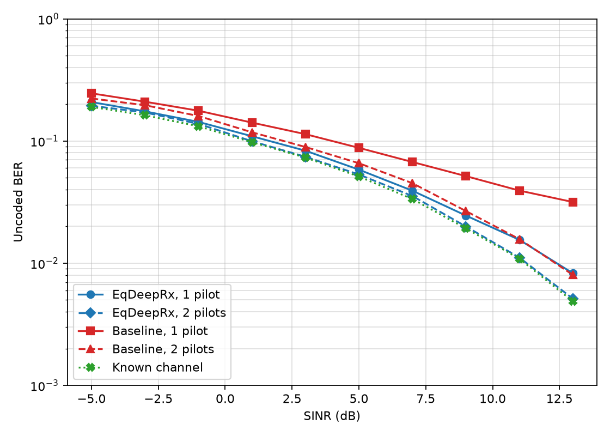

# EqDeepRx: Reproducing Fig. 6(a) Uncoded BER

This repository contains an EqDeepRx implementation, a checkpoint after 70,000 training steps, the step-by-step training log, and an uncoded BER simulation for the CDL-C scenario in Fig. 6(a). The plotted curves cover EqDeepRx, a conventional receiver baseline, and a known-channel reference. The [metrics file](artifacts/strict_fig6a/figure6a_2layers_corrected/figure6a_metrics.json) contains the numerical BER values and the corresponding error and bit counts.



## Repository contents

| Path | Contents |
|---|---|
| `eqdeeprx/` | Signal generation, channel, receiver, neural networks, losses, training, and evaluation code |
| `evaluate_fig6a_corrected.py` | Fig. 6(a) evaluation entry point for the included checkpoint, with checkpoint and source-manifest verification |
| `artifacts/strict_fig6a/eqdeeprx.pt` | Joint model and optimizer checkpoint after 70,000 steps |
| `artifacts/strict_fig6a/training.jsonl` | Per-step training log |
| `artifacts/strict_fig6a/training_source_manifest.json` | SHA-256 hashes of the checkpoint and Python sources used during training |
| `artifacts/strict_fig6a/preflight.json` | Runtime and batch configuration recorded for the training run |
| `artifacts/strict_fig6a/figure6a_2layers_corrected/` | BER plot, metrics, and resumable evaluation progress |

The included checkpoint has `next_step = 70000` and SHA-256 `29dbc07846d748d630fc0ddce41156b06a3d25f46e9a41484015748d8c5a228b`. Use `evaluate_fig6a_corrected.py` for this checkpoint. A new checkpoint trained with the current source tree can be evaluated with `python -m eqdeeprx evaluate`.

## Environment

The recorded run used Windows, Python 3.12.14, an NVIDIA GeForce RTX 5060 Laptop GPU, PyTorch 2.11.0+cu128, Sionna 2.1.0, NumPy 2.5.3, SciPy 1.18.1, and Matplotlib 3.11.1. Package versions are pinned in [requirements.txt](eqdeeprx/requirements.txt). The following PowerShell commands place generated training and evaluation data on the D: drive.

```powershell
git clone https://github.com/Tonyerwite/EqDeepRX.git
Set-Location .\EqDeepRX
py -3.12 -m venv D:\EqDeepRxRuntime\sionna-venv
$py = 'D:\EqDeepRxRuntime\sionna-venv\Scripts\python.exe'
& $py -m pip install -r .\eqdeeprx\requirements.txt
```

## Re-evaluate the included checkpoint

Copy the checkpoint and its source manifest to a separate run directory on D:. The first command verifies the checkpoint without running the Monte Carlo simulation. The second evaluates 32,000 independent slots for each DMRS configuration and writes its outputs to `$runDir\figure6a_2layers_corrected`. If evaluation is interrupted, repeat the second command with `--resume`.

```powershell
$runDir = 'D:\EqDeepRxRuns\from_repository'
New-Item -ItemType Directory -Force -Path $runDir | Out-Null
Copy-Item .\artifacts\strict_fig6a\eqdeeprx.pt $runDir
Copy-Item .\artifacts\strict_fig6a\training_source_manifest.json $runDir
& $py .\evaluate_fig6a_corrected.py --run-dir $runDir --verify-only
& $py .\evaluate_fig6a_corrected.py --run-dir $runDir --samples 32000 --layers 2
```

The evaluation seed is 1,002,026. The plotted SINR bin centers run from -5 to 13 dB in 2 dB increments, with a 2 dB bin width. One-pilot and two-pilot configurations each contribute 32,000 independent slots, for 64,000 generated slots in total. Of these, 28,212 slots fall within the ten plotted SINR bins. The metrics file records the slot count, error count, bit count, and BER for each curve and bin.

## Train and evaluate from scratch

Run preflight in a new directory on D:, then train for 70,000 steps with an effective batch size of 112. Preflight records the GPU, dependency versions, memory settings, source fingerprint, and compute batch sizes used by the training command. A joint checkpoint is saved every 50 completed steps.

```powershell
$trainDir = 'D:\EqDeepRxRuns\from_scratch'
& $py -m eqdeeprx preflight --run-dir $trainDir --microbatch-size 56 --generation-batch-size 2 --repeats 3
& $py -m eqdeeprx train --run-dir $trainDir --steps 70000 --save-every 50 --confirm
```

To resume an interrupted run, use the same directory. After training, evaluate the new checkpoint with the current-source entry point. The plot and metrics are written to `$trainDir\figure6a_2layers`.

```powershell
& $py -m eqdeeprx train --run-dir $trainDir --steps 70000 --save-every 50 --confirm --resume
& $py -m eqdeeprx evaluate --run-dir $trainDir --samples 32000 --layers 2
```

| Training setting | Value |
|---|---|
| Channel and waveform | Online UMa channel generation; OFDM with 30 kHz subcarrier spacing, 192 subcarriers, and 14 OFDM symbols |
| Antennas and layers | 16 receive antennas; one transmit antenna per UE; 2, 3, or 4 layers sampled with equal probability |
| Modulation and DMRS | 64-QAM; one or two DMRS symbols sampled with equal probability; orthogonal pilots on every fourth subcarrier |
| Channel conditions | SNR uniformly sampled over 0-45 dB; UE speed uniformly sampled over 0-35 m/s; zero or one interfering UE sampled with equal probability; INR in dB normally distributed with mean 10 and standard deviation 5 |
| Optimization | LAMB; effective batch size 112; initial learning rate 0.0044, linearly decayed to zero over 70,000 steps; seed 2026; training without channel coding |
| Memory execution | Gradient accumulation over 56-slot compute batches and channel generation in batches of 2; one optimizer update after the full 112-slot batch; bfloat16 convolutions and float32 receiver and loss calculations |
| Network | DenoiseNN widths `[64, 64, 64, 2]`; four DetectorNN sections with 64 channels; DemapperNN widths `[32, 32, 32, 8]`; two time-mixer channels |

The layer, DMRS, and interference sampling probabilities and the number of time-mixer channels are fixed implementation settings. The paper specifies the corresponding training cases and model structure but does not report values for those settings. Additional parameters are defined in [`eqdeeprx/config.py`](eqdeeprx/config.py).

## Fig. 6(a) simulation scenario

| Setting | Included result |
|---|---|
| Channel | 3GPP CDL-C; delay spread uniformly sampled over 10-1100 ns |
| UE speed and interference | 10-15 m/s; one interfering UE with an independent channel and random symbol timing offset |
| Spatial multiplexing | Two layers in the included result; the model is trained across two, three, and four layers. Fig. 6(a) does not state a separate layer count |
| Waveform and receiver | 30 kHz OFDM, 192 subcarriers, 14 symbols, 16 receive antennas, 64-QAM; pilot-based channel estimation and LMMSE reception for the conventional baseline; known-channel reference |
| DMRS and coding | One or two DMRS symbols; transmit-side LDPC encoding with MCS Table 2 indices 11 and 12, respectively; BER measured before LDPC decoding |
| Monte Carlo statistics | 32,000 independent slots per DMRS configuration; per-slot SINR binning; total bit errors divided by the corresponding number of coded transmit bits |

The paper's Fig. 6(a) also includes a DenoiseNN-only curve. The included plot contains the EqDeepRx, conventional baseline, and known-channel curves. [`figure6a_metrics.json`](artifacts/strict_fig6a/figure6a_2layers_corrected/figure6a_metrics.json) is the numerical source for the included plot.

## Reference

M. Honkala, D. Korpi, E. Raninen, and J. M. J. Huttunen, "EqDeepRx: Learning a Scalable and Interference Mitigating MIMO Receiver," arXiv:2602.11834, 2026. [Paper](https://arxiv.org/abs/2602.11834).
